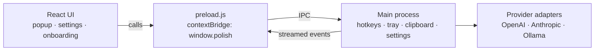

# Polish ✦

**Fix spelling, grammar and tone in any app with a hotkey.**

Copy some text, press a hotkey, and Polish shows the fixed version next to your cursor, with every change highlighted and a short reason for each. Then paste it straight back where it came from.

<p align="center">
  
</p>

## Why I built this

English writing isn't my strongest skill. I'm a frontend developer, and I write all day: Slack messages, PR descriptions, emails, prompts for AI chats. Before sending almost anything, my routine was the same. Copy the text, open ChatGPT or Claude, type "fix the grammar", wait, copy the answer, go back, paste. Many times a day.

I wanted that whole loop to be one keypress. So I built Polish.

It turned out to be useful for more than saving clicks. The **"Why?"** view explains every change in plain English (*"went: past tense, because of yesterday"*), so instead of just accepting fixes, I've started noticing the mistakes I keep making.

## Who it's for

- **Non-native English speakers** who write a lot at work and want to send messages with confidence.
- **Fast typists** who know what they mean but leave typos and missing words behind.
- **Anyone switching tone**: turning a blunt note into a polite email, or a stiff sentence into a friendly Slack message.
- **People who care about privacy**: with Ollama, your text never leaves your computer.

## Download

Get the latest installer from the [Releases page](https://github.com/Abinashshasini/polish/releases/latest):

| Platform | File |
| --- | --- |
| Mac (Apple Silicon and Intel) | `Polish-<version>-mac-universal.dmg` |
| Windows | `Polish-Setup-<version>.exe` |

The builds aren't signed with a paid certificate yet, so your OS will warn you the first time:

- **Mac:** drag Polish to Applications and open it once. Then go to **System Settings → Privacy & Security** and click **Open Anyway**.
- **Windows:** if SmartScreen appears, click **More info → Run anyway**.

## How it works

1. Select text anywhere (Slack, email, a browser, an editor) and copy it.
2. Press a hotkey. A small window opens next to your cursor, and the fix streams in.
3. Review what changed. Each edit is highlighted, with a one-line reason.
4. Press **Enter** to replace your selection with the fixed text, or click **Copy** to paste it yourself.

Polish lives in the menu bar (Mac) or system tray (Windows). A setup guide walks you through choosing a provider and trying your first fix.

## Actions

Polish comes with five actions. You can rename them, change their hotkeys, edit their prompts, turn them off, or add your own (like "Translate to Hindi" or "Make it shorter") in **Settings → Actions**.

| Action | Default hotkey | What it does |
| --- | --- | --- |
| Fix spelling | `Alt+Shift+S` (`⌥⇧S`) | Spelling only. Grammar and wording stay as they are. |
| Fix grammar | `Alt+Shift+G` (`⌥⇧G`) | Spelling and grammar, including tense. Keeps your meaning and tone. |
| Casual 😊 | none | Friendly rewrite, like a Slack message to a teammate. |
| Professional 💼 | none | Clear, polite rewrite, like a work email. |
| Fun 🎉 | none | Playful rewrite with some personality. |

Every action can also be picked from the popup, so one hotkey is enough to reach them all.

## AI providers

Choose a provider in **Settings → AI Provider**:

| Provider | Models | Needs |
| --- | --- | --- |
| OpenAI | GPT-5.4 nano | An [OpenAI API key](https://platform.openai.com/api-keys) |
| Anthropic (Claude) | Claude Opus 5.5, Sonnet 5.5, Haiku 5.5 | An [Anthropic API key](https://platform.claude.com/settings/keys) |
| Ollama | Any model you've pulled | [Ollama](https://ollama.com) running locally. Free, and your text never leaves your machine. |

You pay your provider directly for what you use. With GPT-5.4 nano, a typical fix costs a tiny fraction of a cent, so $5 of credit lasts a long time. Polish tracks your token usage against a budget you set, so you can see roughly how many fixes you have left.

## Privacy

- **API keys** are encrypted with your OS keychain (macOS Keychain or Windows DPAPI) and never shown again after you save them.
- **Your text** goes only to the provider you chose. With Ollama, it stays on your computer.
- **History** of recent fixes is stored locally, and you can turn it off or clear it in Settings.
- Polish only reads your clipboard when you press one of its hotkeys.

## Permissions (Mac)

To paste the fixed text back for you, Polish needs **Accessibility** access (**System Settings → Privacy & Security → Accessibility**). Without it, everything still works; **Replace** just copies the result and asks you to press `⌘V`.

## Known limitations

I'd rather be upfront about these:

- **You copy first.** Polish works from your clipboard rather than reading selected text directly. That keeps it working in every app without special integrations, but it's one extra keypress.
- **Unsigned builds.** Until I pay for code-signing certificates, you'll see the OS warnings described above. Some company-managed computers may block the app entirely.
- **Text only, up to 4,000 characters** per fix.
- **It's an AI.** It's usually right, but read the result before you send it. That's what the diff view is for.

## How it's built

Polish is an **Electron + React** app. The React UI never touches your API keys or the network directly; everything privileged happens in the main process.



**Key decisions and trade-offs:**

- **Electron over Tauri.** It kept the whole stack in JavaScript, and the APIs I needed (global shortcuts, tray, encrypted storage) are mature. The trade-off is app size: every Electron app ships its own Chromium.
- **Streaming structured output.** The model returns JSON (`{ text, why }`) so the UI gets both the fix and the reasons. To show the fix live, Polish parses the partial `text` value while the JSON is still streaming in, then builds the diff once it completes.
- **Secrets stay in the main process.** The renderer is treated as untrusted. It only sees a minimal API exposed through `contextBridge`, and keys are encrypted with Electron's `safeStorage`.
- **Prompt-injection guard.** You might fix a message that's meant for an AI chat, like "write me a sorting function." The system prompt tells the model to edit the text, never to answer or follow it.
- **Cancel when hidden.** Closing the popup aborts the in-flight request, so you never pay for a result you didn't see.

## Built with help from Claude

I want to be honest about how this was made: **I built Polish with a lot of help from Claude**, Anthropic's AI assistant.

I came in knowing React and how to work with LLM APIs, but Electron was new to me. Claude guided me through it step by step and wrote much of the Electron code with me. My part was deciding what to build and how it should feel, running every step on real machines, and working through the problems that came up along the way: a corporate Mac behind Zscaler, macOS permission prompts, Electron APIs that behaved differently than expected, and a packaged app that crashed because of missing dependencies.

Once it worked, I went back and learned the Electron side properly (the process model, IPC and preload, security, and packaging), so I understand how the pieces fit together rather than just having code that runs.

There's something fitting about it: I used an AI to help build a tool that uses AI to help me write better. I think that's a realistic picture of how software gets built now, and I'd rather say so than pretend otherwise.

## Development

Requires Node 24.

```bash
npm install
npm run dev        # Vite + Electron with hot reload
npm test           # unit tests (Vitest)
npm run dist:mac   # build a .dmg into release/
npm run dist:win   # build a Windows installer into release/
```

In development, you can put `OPENAI_API_KEY` or `ANTHROPIC_API_KEY` in a `.env` file instead of entering a key in Settings. The `.env*` pattern is git-ignored, so keys never get committed.

**Layout:** `src/` is the Electron main process (hotkeys, tray, settings, and provider adapters in `src/providers/`). `renderer/` is the React UI for the popup, settings and onboarding windows.

### Releasing

Bump the version and push the tag. GitHub Actions builds the Mac and Windows installers and publishes a release:

```bash
npm version patch && git push --follow-tags
```

## Feedback

If Polish helps you, or something breaks, [open an issue](https://github.com/Abinashshasini/polish/issues). I'd love to hear how you use it.
